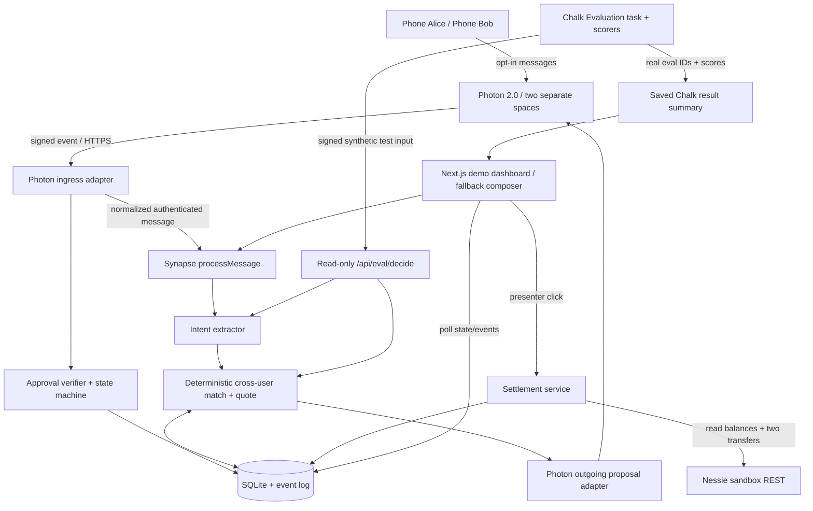

# Synapse — HackHarvard 2026 Build Specification

**Version 2.0 — Sponsor-first revision · Saturday, October 17, 2026**  
**Hard submission deadline:** Sunday, October 18, 2026, 8:00 a.m. ET  
**Primary targets:** **Photon 2.0** (messaging-agent product), **Capital One Nessie** (working sandbox money movement), **Chalk** (real agent evaluation). **Digital Trust** is a secondary category, not a substitute for the three working integrations.

## Assumptions and non-negotiable decisions

1. **One story, two people, one product:** Alice and Bob independently tell Synapse, via *separate opted-in messaging conversations*, that they need a desk lamp next week in Boston. Synapse discovers that a shared two-item order is cheaper, offers each person an opportunity, receives individual consent, and funds a simulated shared purchase via Nessie. No unsolicited access to conversations, contacts, or transaction histories.
2. **Fixture economics are explicit:** two separate orders cost `2 × ($40 item + $5 shipping) = $90`; a **synthetic** two-lamp bundle costs `$60 + $8 shipping = $68`. Each contributes **$34** and would save **$11** versus ordering alone; total potential savings **$22**. The merchant offer is invented for the hackathon and is never claimed to be real.
3. **Messaging architecture:** **one actual Photon 2.0 agent line** serving two independently scoped users/spaces is enough. Alice's and Bob's personal agents are separate *logical agent states* behind that line; do not spend time acquiring two separate phone numbers. **Live inbound Photon messages and outbound proposals/replies are priority MVP work**, not stretch goals. Photon does not give blanket access to iMessage history.
4. **Banking architecture:** actual Nessie sandbox customer accounts and approved transfers are priority MVP work. There is no real money, merchant checkout, or refunds. Nessie account setup/deposits must be verified against the provider docs before live execution. Demo resets in live mode must use fresh/reconciled sandbox accounts, **not silently reset real Nessie state**.
5. **Chalk architecture:** run a **real Chalk evaluation** of Synapse's matching/intent behavior on a **synthetic labeled dataset** and display an actual evaluation/run reference and measured score. Chalk is not a runtime dependency for approving or transferring money. Never imply a local Vitest run was a Chalk evaluation.
6. **Provider access is a hard prerequisite, not something to postpone:** at project start, immediately provision Photon credentials/channel, Nessie key/accounts, and Chalk environment. If one service is unavailable, log the blocker, implement its adapter against a documented contract, and continue building the other two. All providers have explicit mock modes for rehearsal; they must never masquerade as live integrations.
7. **Deployment:** one Next.js Node server, SQLite database on persistent storage, public HTTPS URL for Photon webhook and Chalk eval calls; local development can use an HTTPS tunnel. Single process/instance to keep SQLite simple.
8. **Privacy and payments:** only fictional opted-in users; raw messages aren't shared between users; no external action without each affected user's affirmative approval; all arithmetic in integer cents; transfer retries never occur on ambiguous outcomes. Demo browser personas are not real identity authentication.
9. **Versions:** prefer the pins below. If a provider's API or package differs in the live account, consult its current authenticated docs, record exact observed behavior in `DECISIONS.md`, and change **only its adapter**. Do not fabricate response bodies, webhook signatures, deliveries, or evaluation results.

## 1. Summary

**Synapse** is a passive, permissioned social financial agent that discovers compatible purchasing intentions across independent conversations and coordinates mutually beneficial joint orders without users explicitly asking it to find deals. Its core users are friends and family who already express plans through messaging but don't know when their needs overlap. In the live demo, Alice and Bob text the Synapse Photon number independently, and their separate agents discover a synthetic lamp bundle saving them $22 combined. Synapse texts each a proposal, obtains separate approvals, executes two real **Nessie sandbox** contributions, and displays the resulting account balances; a **Chalk evaluation** shows how reliably the matching engine identifies opportunities without false positives.

## 2. Scope

### Strict MVP (required in this order of importance)

1. **Live Photon intake and response:** two consented test phones send ordinary messages to the same Photon 2.0 agent number in separate conversation spaces; receive replies/proposals through Photon. Support an inbound `YES OPP-001` / `NO OPP-001` response from the correct enrolled sender. Record provider message IDs and message-source provenance. Live inbound is the target; a verified signed webhook is required before activating it.
2. **Two independent personal contexts:** SQLite stores separate Alice/Bob messages and structured purchase intents. No cross-user raw message disclosure. Deterministic fallback message intake through the dashboard remains available.
3. **Automatic opportunity discovery:** after Bob's message, without a “Find deals” click, find the shared `desk-lamp` need in `Boston` with a compatible 7-day window; generate exactly one opportunity and its immutable synthetic quote ($90 separately, $68 together, $22 saved).
4. **Negotiation/approval via Photon:** text identical quote terms to each consenting participant; accept approval only from that participant's mapped Photon sender; rejection closes the opportunity. Dashboard buttons may represent approvals only in explicitly labeled local rehearsal mode.
5. **Working Nessie transfers:** read/verify Alice, Bob, and Pool balances from the sponsor API; after two approvals **and an explicit presenter “Execute sandbox contributions” click**, transfer exactly $34 from each payer to Pool. Persist provider IDs, show reconciled balances, and prevent double execution. Sandbox provenance must be obvious.
6. **Real Chalk evaluation:** run at least 20 synthetic positive/negative intent-pair cases against the *actual Synapse matching decision path*, with ground truth. Show measured match accuracy and false-positive count, and link/store the actual Chalk evaluation ID, run ID, and result summary. Don't use raw user messages as evaluation data.
7. **One clear dashboard:** live source status for Photon, Nessie, Chalk; independent chat/agent lanes; discovered-opportunity card; timeline; transfers and balances; evaluation panel; a **Reset local demo** action for mock mode. Poll every 2 seconds.
8. **Unit/integration tests:** positive match, negation/no-match, duplicate webhook, quote math, participant approval authorization, second-click idempotency, insufficient balance, partial/unknown transfers, and evaluation dataset outcomes.

### Stretch goals (only after real sponsor integrations are verified)

- An additional product scenario; optional LLM extraction of paraphrased buying intentions with deterministic gate; a compact social-network graph; live Photon read receipts/delivery status *if the account exposes it*; Chalk model-based quality judge; private matching beyond minimum-necessary field exchange; actual vendor catalogs; true user authentication.

### Explicitly out of scope

Background monitoring of arbitrary iMessages; access to other people's messages; multiple Photon agent numbers; group chat bots; real merchant purchases; automatic spending; real customer money; broad shopping search; vendor negotiations; authentic bulk discounts; cross-provider bank aggregation; automatic refunds; custom cryptography; 3D simulations; a general budgeting assistant; adding unrelated sponsor SDKs solely for eligibility.

## 3. User flow — exact five-minute judge path

**Preflight (before judging):** public app running, two test phones/Photon spaces enrolled, freshly provisioned Nessie demo accounts with **Alice $100**, **Bob $100**, **Pool $0**, and completed Chalk eval ID/result persisted. Admin has verified `LIVE` source badges with actual provider checks. Local mock fallback is on standby and visibly differentiated.

1. **0:00–0:30 — Show empty state.** Open `/`. Dashboard displays two independent *agent* lanes, “Waiting for intent” and the three Nessie balances. Show Photon/Nessie/Chalk status and evaluation accuracy panel briefly.
2. **0:30–1:15 — Alice texts normally.** Alice sends `I need a desk lamp for my room next week in Boston` to Photon. Her separate lane changes to `Intent found: desk-lamp`, the event stream shows `photon.inbound_verified`, and no opportunity exists yet.
3. **1:15–2:00 — Bob texts independently.** Bob sends `I'm buying a desk lamp next week in Boston too`. Synapse records his intent, automatically finds an overlap, and shows `$90 individual → $68 together`, `$22 saved` under a **Synthetic offer** label. Neither user asks the agent to compare deals.
4. **2:00–2:45 — Agents coordinate via Photon.** Alice and Bob receive separate, minimal-information Photon proposals: `OPP-001: $34 each; estimated savings $11 each. Reply YES OPP-001 or NO OPP-001.` Neither message contains the other's full text or balance.
5. **2:45–3:30 — Real approvals.** Alice replies `YES OPP-001`; dashboard becomes `1/2`. Bob replies `YES OPP-001`; dashboard becomes `2/2`. No payment has happened yet. Wrong sender or wrong opportunity code is rejected.
6. **3:30–4:15 — Real sandbox execution.** Presenter clicks `Execute sandbox contributions`; backend executes two once-only Nessie transfers and fetches all three balances again. Display **$66 / $66 / $68**, two returned transfer IDs, and `provider=nessie`. Repeat-click proves no duplicate payment.
7. **4:15–5:00 — Evidence.** Show the saved Chalk evaluation: real run ID, sample size, match accuracy, false positives, and a negative test that the agents correctly ignored. Close: “Two independent conversations, one financial opportunity, no manual coordination.”

**If live Photon messages are delayed:** use the `Inject Alice/Bob demo message` web intake, mark `source=web_demo`, and still show tested Photon outbound. **If live Nessie is unavailable:** switch to `mock` with a highly visible `MOCK BANK` badge and do not claim the Nessie prize integration succeeded. **If Chalk is unavailable:** show local tests with `CHALK UNAVAILABLE`, not fabricated Chalk scores. The team should prioritize fixing these gaps ahead of UI polish.

## 4. Architecture



- **Server:** Next.js App Router route handlers, `runtime="nodejs"`, one writable process. Never call provider APIs from the browser.
- **Database:** SQLite with WAL and foreign keys, provider identity mappings, messages, intents, offers, opportunities, approvals, transfer ledger, events, evaluation reports. Only synthetic demo messages are stored; do not persist arbitrary personal conversations.
- **Agent separation:** Alice/Bob each have distinct logical agent context keyed to verified Photon sender/space. A shared match engine may see only *structured consented purchase intentions*.
- **Provider adapters:** `PhotonAdapter` handles provider IDs, outbound messages, and authenticated inbound normalization; `BankAdapter` handles sandbox accounts/transfers. Explicit provider mode `live | mock | degraded` tracked per call.
- **Chalk:** pinned labeled test cases; its task invokes a protected stateless `/api/eval/decide` route that calls **the same** intent+matching functions as production (without storing messages or touching Nessie). Chalk saves task/scorer versions and actual evaluation results. Chalk does not arbitrate payment safety.
- **Progress and observability:** append a timeline event for each state transition; expose source badges based on verified call results, not environment values alone.

## 5. Tech stack — exact pins

| Software/service | Pin | Purpose |
|---|---|---|
| Node.js / npm | `22.18.0` / `10.9.3` | Reproducible one-process server |
| Next.js | `15.5.6` | UI and webhook/API routes |
| React / react-dom | `19.2.0` / `19.2.0` | Demo dashboard |
| TypeScript | `5.9.3` | Typed domain and adapters |
| better-sqlite3 / @types/better-sqlite3 | `12.11.1` / `7.6.13` | Reliable local database |
| Zod | `4.1.12` | Strict input/output validation |
| lucide-react | `0.468.0` | Icons |
| Vitest | `3.2.4` | Local deterministic tests |
| tsx | `4.20.6` | Scripts |
| @types/node / @types/react / @types/react-dom | `22.18.13` / `19.2.2` / `19.2.2` | TS declarations |
| Python | `3.12.x` (use `3.12.10`) | Separate Chalk eval runner only |
| chalkcompute / pyarrow | `2.3.0` / `21.0.0` | **Real Chalk Compute evaluation**, separate pinned Python environment |
| Photon 2.0 | Beta REST `/v1` | Inbound/outbound messages through verified provider adapter; use built-in Node `fetch` |
| Nessie | REST `v1.0` | Actual sandbox accounts, balances, transfers; Node `fetch` |
| Deployment | Railway Node service + persistent volume; HTTPS tunnel for local | Public webhook/eval endpoint |

Do **not** combine Photon Spectrum Stable (`spectrum-ts`) and Photon Beta credentials/contracts. No Redis, Kafka, separate Python app server, general multi-agent framework, or open-ended LLM requirement. Exact JavaScript versions are installed without `^`/`~`; commit `package-lock.json`. Python `requirements-chalk.txt` pins the two packages. If a pin is unavailable, document the compatible substitution and obtain approval before changing the stack.

## 6. Data model (SQLite)

IDs are `TEXT` UUIDs except seeded `alice`, `bob`, `pool`; UTC timestamps are ISO strings. Currency values are `INTEGER` cents. Use `CHECK` constraints for finite enum values.

| Table | Columns |
|---|---|
| `users` | `id TEXT PRIMARY KEY`, `name TEXT NOT NULL`, `phone_e164 TEXT UNIQUE`, `consented INTEGER NOT NULL`, `created_at TEXT NOT NULL` |
| `photon_spaces` | `user_id TEXT PRIMARY KEY REFERENCES users(id)`, `photon_user_id TEXT UNIQUE`, `photon_space_id TEXT UNIQUE`, `platform TEXT`, `verified INTEGER NOT NULL DEFAULT 0`, `updated_at TEXT` |
| `messages` | `id TEXT PRIMARY KEY`, `user_id TEXT REFERENCES users(id)`, `source TEXT` (`photon`/`web_demo`), `provider_message_id TEXT UNIQUE`, `text TEXT NOT NULL`, `created_at TEXT` |
| `intents` | `id TEXT PRIMARY KEY`, `message_id TEXT UNIQUE REFERENCES messages(id)`, `user_id TEXT REFERENCES users(id)`, `sku TEXT`, `quantity INTEGER`, `region TEXT`, `need_by TEXT`, `confidence REAL`, `active INTEGER` |
| `offers` | `id TEXT PRIMARY KEY`, `sku TEXT`, `solo_item_cents INTEGER`, `solo_shipping_cents INTEGER`, `bundle_items_cents INTEGER`, `bundle_shipping_cents INTEGER`, `synthetic INTEGER NOT NULL`, `version INTEGER NOT NULL` |
| `opportunities` | `id TEXT PRIMARY KEY`, `code TEXT UNIQUE`, `user_a_id TEXT`, `user_b_id TEXT`, `offer_id TEXT`, `quote_version INTEGER`, `separate_cents INTEGER`, `group_cents INTEGER`, `per_person_cents INTEGER`, `status TEXT` (`proposed`/`approved`/`rejected`/`settling`/`settled`/`partial_failure`), `created_at TEXT`, `UNIQUE(user_a_id,user_b_id,offer_id)` |
| `approvals` | `opportunity_id TEXT`, `user_id TEXT`, `quote_version INTEGER`, `decision TEXT` (`approved`/`rejected`), `source TEXT`, `created_at TEXT`, `PRIMARY KEY(opportunity_id,user_id)` |
| `accounts` | `id TEXT PRIMARY KEY`, `user_id TEXT NULL`, `provider TEXT` (`mock`/`nessie`), `external_id TEXT UNIQUE`, `last_balance_cents INTEGER`, `updated_at TEXT` |
| `transfers` | `id TEXT PRIMARY KEY`, `opportunity_id TEXT`, `payer_id TEXT`, `idempotency_key TEXT UNIQUE`, `provider TEXT`, `external_transfer_id TEXT`, `amount_cents INTEGER`, `status TEXT` (`pending`/`succeeded`/`failed`/`unknown`), `error TEXT`, `created_at TEXT`, `UNIQUE(opportunity_id,payer_id)` |
| `events` | `seq INTEGER PRIMARY KEY AUTOINCREMENT`, `kind TEXT`, `user_id TEXT NULL`, `opportunity_id TEXT NULL`, `details_json TEXT`, `provider TEXT NULL`, `created_at TEXT` |
| `evaluation_reports` | `id TEXT PRIMARY KEY`, `provider TEXT` (`chalk`/`local`), `evaluation_id TEXT NULL`, `run_id TEXT NULL`, `dataset_size INTEGER`, `accuracy REAL`, `false_positives INTEGER`, `source_version TEXT`, `result_json TEXT`, `created_at TEXT` |

**Schemas and pure functions:**

```ts
import { z } from 'zod';
export const IntentSchema = z.object({
  sku: z.literal('desk-lamp'), quantity: z.literal(1),
  region: z.literal('Boston'), needBy: z.iso.date(),
  confidence: z.number().min(0).max(1)
});
export type PurchaseIntent = z.infer<typeof IntentSchema>;
export function extractIntent(text: string, today: string): PurchaseIntent | null;
export function findOpportunity(a: PurchaseIntent | null, b: PurchaseIntent | null): boolean;
export function quoteOffer(): { separateCents: 9000; groupCents: 6800; perPersonCents: 3400; savingsCents: 2200 };
export async function processMessage(userId: string, text: string, providerMessageId?: string): Promise<{ messageId: string; opportunityId: string | null }>;
export async function decide(opportunityId: string, userId: string, decision: 'approved'|'rejected', quoteVersion: number, source: 'photon'|'web_demo'): Promise<void>;
export async function settleOpportunity(opportunityId: string, bank: BankAdapter): Promise<TransferResult[]>;
export function evaluatePair(a: string, b: string, today: string): { matched: boolean; savingsCents: number }; // stateless: same extractIntent + findOpportunity
```

`extractIntent` requires buying intent, `desk lamp`, `Boston`, a date reference (`next week` => `2026-10-24` with `DEMO_TODAY=2026-10-17`); reject negations (“not buying”), someone else's intention, or unsupported product/region. `findOpportunity` requires distinct opted-in users in the real service, same SKU/region, and need-by dates within 7 days; `evaluatePair` models the two users as separate and uses exactly the same matching functions. Quote is constant for this labeled synthetic offer. Avoid LLM arithmetic.

## 7. API contract

All internal routes use JSON and the error shape `{ "error": {"code":"SNAKE_CASE", "message":"..."} }`. All provider-returned IDs are opaque strings. Send API secrets only from server-side code. Authenticated admin and evaluation routes require their respective headers even in deployed demo mode.

| Method / endpoint | Request | Success response | Errors |
|---|---|---|---|
| `GET /api/health` | none | `200 {"ok":true,"db":"ready","photon":"live|mock|degraded","nessie":"live|mock|degraded","chalk":"live|mock|unavailable"}`; statuses reflect verified operations | 503 DB failure |
| `GET /api/demo/state?viewer=admin|alice|bob` | query `viewer`; admin requires `X-Demo-Admin-Key` | `200 {"users":[],"accounts":[],"messages":[],"intents":[],"opportunities":[],"events":[],"evaluation":null}`; keys always present, arrays populated from DB | 400 viewer; 401 admin secret; 403 cross-user access |
| `POST /api/demo/reset` | header `X-Demo-Admin-Key`, `{ "confirm":"RESET_LOCAL_ONLY" }` | `200 {"reset":true,"provider":"mock"}` | 400/401; **403** for Nessie live mode; 409 settlement in progress |
| `POST /api/messages` | `{ "userId":"alice", "text":"I need a desk lamp next week in Boston", "source":"web_demo", "externalEventId":null }` | `201 {"messageId":"...","intentDetected":true,"opportunityId":null}`; second message includes opportunity ID; dedup returns 200 existing ID | 400 invalid/over 500 chars; 403 web input disabled; 409 duplicate conflict |
| `POST /api/photon/webhook` | **Photon native signed event**; verify exact signature/header/event JSON against current Photon Beta docs before enabling; normalize to sender + space + message ID + body | Provider-compatible `2xx` acknowledgment; records `photon.inbound_verified` and routes message or consent decision | 401 bad signature; 422 unknown/unenrolled user; duplicate events acknowledged without reprocessing |
| `POST /api/photon/send-test` | admin header, `{ "userId":"alice","text":"Synapse connection check" }` | `200 {"provider":"photon","providerMessageId":"...","accepted":true}`; **not** delivered/seen claim | 400 unknown user, 401, 502 send failure |
| `POST /api/opportunities/:id/decision` | local demo only `{ "userId":"alice","decision":"approved","quoteVersion":1 }` | `200 {"status":"proposed|approved|rejected","approvals":1,"required":2}` | 403 in live Photon approval mode / nonparticipant; 409 wrong version or closed |
| `POST /api/opportunities/:id/settle` | admin header, `{ "confirm":"EXECUTE_SANDBOX" }` | `200 {"status":"settled","transfers":[{"payerId":"alice","amountCents":3400,"provider":"nessie","transferId":"...","status":"succeeded"}]}`; always return **both** transfer objects when settled | 401; 409 missing approvals/partial; 502 provider error before any mutation; ambiguous outcome => persistent `partial_failure` and no automatic retry |
| `GET /api/events?after=0` | nonnegative cursor; admin header | `200 {"events":[{"seq":1,"kind":"...","provider":"photon","details":{},"createdAt":"..."}],"nextAfter":1}` | 400 cursor; 401 admin |
| `POST /api/eval/decide` | header `X-Synapse-Eval-Token`, `{ "aliceText":"...","bobText":"...","today":"2026-10-17" }` | `200 {"matched":true,"savingsCents":2200}`; **read-only, stateless, no DB write or provider calls** | 400 malformed; 401 bad token; 429 request limit |
| `POST /api/chalk/report` | admin header, `{ "provider":"chalk", "evaluationId":"...","runId":"...","datasetSize":20,"accuracy":0.95,"falsePositives":0,"sourceVersion":"<git sha>","result":{} }` | `201 {"id":"...","stored":true}` only after server validates IDs and a report generated by the authenticated local Chalk runner; do not trust arbitrary browser claims | 400/401/409 invalid/duplicate; server marks provenance |
| `GET /api/chalk/results` | none | `200 {"provider":"chalk|local|unavailable","evaluationId":null,"runId":null,"datasetSize":0,"accuracy":null,"falsePositives":null}`; replace with actual persisted report | 503 DB unavailable |

**Webhook safety:** Photon 2.0 supports HTTP webhooks/streams, but exact message-event fields and signing details are deployment-specific. Obtain a **real event**, official Beta webhook configuration/signature description, and a valid signing secret. Verify the **raw body** and timestamp/signature as prescribed by the actual Beta provider documentation, then map `senderId`/space to enrolled Alice/Bob. **Do not use webhook examples from `photon.health` (different company), Photon Engine, or Photon Spectrum Stable.** If signing cannot be verified, reject the webhook; use web fallback while fixing provider access. `photon_spaces` must be populated only after the live provider confirms user and space IDs. Only mapped sender identity may approve.

**Photon outbound request shape confirmed by the Oct. 15 Photon 2.0 example** (`https://photon.codes/blog/introducing-photon-2.0`): base `https://api.photon.codes/v1/projects/{PHOTON_PROJECT_ID}`, bearer key and `idempotency-key` header; `POST /users {platform:"imessage",handle:"+1..."}`, `POST /spaces {platform:"imessage",participantIds:[agentId,participantId]}`, `POST /messages {spaceId,senderId:agentId,content:{type:"text",format:"plain",text:"..."}}`. Reuse stored IDs. Provider HTTP acceptance is not message delivery. `PhotonAdapter.send(userId,text,dedupeKey)` must return accepted provider ID or explicit error.

**Nessie live contract:** `BankAdapter.getBalance(accountId):Promise<number>` and `BankAdapter.transfer({fromId,toId,amountCents,idempotencyKey}):Promise<{transferId:string;status:'succeeded'|'failed'|'unknown'}>`. Validate actual Nessie docs at `https://prod.nessieisreal.com/docs`. **Candidate** historical endpoint: `GET /accounts/{id}?key=...`, `POST /accounts/{payerId}/transfers?key=...` with `medium`, `payee_id`, `amount`, `transaction_date`, `description`, `status`. This payload is **unverified on the team's key**; verify with a disposable 1-cent transfer and record actual API response. Load accounts by provisioned real IDs, seed balances via documented account/deposit endpoints if necessary, and verify balances before the demo. Each payment goes through locked DB state transitions. Execute Alice then Bob, record success/unknown durably, never retry unknown funds automatically. End state must be reconciled from Nessie reads, not presumed from local math.

**Chalk live contract:** real evaluation uses **Chalk Compute** (documentation: `https://docs.chalk.ai/docs/evaluations/quick-start` and `/scorers`), **not a local evaluation branded as Chalk**. In `chalk/eval_synapse.py`, define a deployed `@chalkcompute.function` task with signature `def evaluate_pair(aliceText: str, bobText: str, today: str) -> str`. It performs a signed `urllib.request` POST to the hosted `/api/eval/decide` route and returns JSON encoded as text. Upload 20+ synthetic test pairs through `chalkcompute.DatasetClient().upload`; each row contains `aliceText`, `bobText`, `today`, and `expected` as `{"matched":bool,"savingsCents":int}` JSON string. Use `chalkcompute.scorers.json_valid(name="valid-json")` and `chalkcompute.scorers.json_match(inputs=("output","expected"), paths=["matched","savingsCents"], name="decision-match")`; add a custom `@chalkcompute.function` scorer for false-positive counts if feasible. Create with `chalkcompute.Evaluation.create(...,dataset=...,task=evaluate_pair,scorers=[...])`; execute `.run(metadata={"git_sha":...}).wait()`, then read the result dataset and summarize scores. Configure remote function environment/secret access via the authenticated Chalk environment; do not embed the API token in source. Commit only generated aggregate evidence/IDs, not secrets. **If Chalk cannot call the public endpoint** because egress/secrets are unavailable, run a Chalk evaluation over **recorded outputs from real Synapse test requests** (each row has actual prediction and expected value) with Chalk scorers, clearly label it `Chalk scored recorded Synapse outputs` rather than `Chalk executed agent`. If the environment cannot run any evaluation, show `unavailable`.

## 8. Full project tree

```text
synapse/
├── .env.example
├── .gitignore
├── .nvmrc
├── .python-version
├── README.md
├── DECISIONS.md
├── SPONSOR_PROOFS.md
├── package.json
├── package-lock.json
├── requirements-chalk.txt
├── next.config.ts
├── tsconfig.json
├── vitest.config.ts
├── public/synapse-mark.svg
├── data/.gitkeep
├── src/
│   ├── app/
│   │   ├── layout.tsx
│   │   ├── page.tsx
│   │   ├── globals.css
│   │   └── api/
│   │       ├── health/route.ts
│   │       ├── demo/state/route.ts
│   │       ├── demo/reset/route.ts
│   │       ├── messages/route.ts
│   │       ├── photon/webhook/route.ts
│   │       ├── photon/send-test/route.ts
│   │       ├── opportunities/[id]/decision/route.ts
│   │       ├── opportunities/[id]/settle/route.ts
│   │       ├── events/route.ts
│   │       ├── eval/decide/route.ts
│   │       ├── chalk/report/route.ts
│   │       └── chalk/results/route.ts
│   ├── components/
│   │   ├── SponsorStatus.tsx
│   │   ├── AgentLane.tsx
│   │   ├── OpportunityCard.tsx
│   │   ├── Timeline.tsx
│   │   ├── Ledger.tsx
│   │   └── EvaluationCard.tsx
│   ├── lib/
│   │   ├── env.ts
│   │   ├── db.ts
│   │   ├── schema.sql
│   │   ├── seed.ts
│   │   ├── types.ts
│   │   ├── validation.ts
│   │   ├── events.ts
│   │   ├── intent.ts
│   │   ├── matching.ts
│   │   ├── quotes.ts
│   │   ├── messaging-service.ts
│   │   ├── opportunities.ts
│   │   ├── settlement.ts
│   │   └── adapters/
│   │       ├── photon.ts
│   │       ├── photon.live.ts
│   │       ├── photon.mock.ts
│   │       ├── bank.ts
│   │       ├── bank.nessie.ts
│   │       └── bank.mock.ts
│   └── tests/
│       ├── intent.test.ts
│       ├── matching.test.ts
│       ├── quotes.test.ts
│       ├── photon-normalization.test.ts
│       ├── approvals.test.ts
│       ├── settlement.test.ts
│       ├── eval.test.ts
│       └── api.test.ts
├── chalk/
│   ├── eval_synapse.py
│   ├── dataset.jsonl
│   └── README.md
└── scripts/
    ├── init-db.ts
    ├── reset-local.ts
    ├── smoke-photon.ts
    ├── smoke-nessie.ts
    ├── smoke-chalk.py
    └── record-sponsor-proofs.ts
```

## 9. Ordered build plan — milestones under 60 minutes each

**A milestone isn't complete without its acceptance check and a commit. Check sponsor credentials before optional features. Work through the numbered milestones in order; provider failures are recorded early rather than silently deferred.**

| # | Work and files | Done when |
|---|---|---|
| **1. Runnable complete thin slice** | Scaffold pinned Next/TS/CSS, `page.tsx`, `api/health`, `intent.ts`, `matching.ts`, `quotes.ts`, in-memory fixture. Two web panels → automatic match → two approvals → mock balances. | `npm ci && npm run dev` starts; both messages create one `$22` savings card; approved mock $34+$34 contributions leave $66/$66/$68. **End-to-end works now**, however ugly. Commit `M1`. |
| **2. Sponsor access and smoke gates** | `.env.example`, `env.ts`, `scripts/smoke-photon.ts`, `scripts/smoke-nessie.ts`, `scripts/smoke-chalk.py`, `SPONSOR_PROOFS.md`. Create Photon 2.0 project/line, Nessie key/three accounts, Chalk environment. | **Attempt real requests now**: Photon sends a message to an enrolled phone, Nessie reads a genuine balance (and tests 1-cent disposable transfer when account ready), Chalk authenticates and runs minimal documented quick-start eval. Record actual observed IDs/errors per sponsor. Explicitly note any unmet gate. Commit `M2`. |
| **3. Persistence and provider identity** | `schema.sql`, `db.ts`, `seed.ts`, `scripts/init-db.ts`, `scripts/reset-local.ts`, `types.ts`, demo state/reset API. Save Photon user/space IDs and Nessie account IDs separately from mock IDs. | SQLite survives refresh; mock reset reproducible; Nessie live mode cannot use mock reset; account IDs never leak to browser. Commit `M3`. |
| **4. Live Photon inbound/outbound** | `photon.live.ts`, `photon.ts`, webhook route, `messaging-service.ts`, normalization tests, tunnel/public endpoint config. Verify actual Beta signed event before enabling. | Two test phones send to Photon; backend records verified distinct sender IDs/spaces; outbound test message reaches both phones (show evidence separately from HTTP accepted); duplicates ingest only once. If provider blocks, keep failing live integration visible and proceed via local messages. Commit `M4`. |
| **5. Match + quote via real messages** | `intent.ts`, `matching.ts`, `quotes.ts`, `opportunities.ts`, `api/messages`, tests, `OpportunityCard.tsx`. | First Photon message produces no deal; second produces exactly one OPP-001, complete `$90/$68/$22` quote, and two Photon proposals. False-positive cases do not match. Commit `M5`. |
| **6. Photon replies + safe approvals** | webhook reply routing, `opportunities.ts`, decisions route, approval tests, timeline. | `YES OPP-001` from Alice yields 1/2; Bob's YES yields 2/2; spoofed sender/NO/wrong code cannot authorize settlement; **no money moves yet**. Commit `M6`. |
| **7. Nessie live settlement** | `bank.nessie.ts`, `bank.mock.ts`, `bank.ts`, `settlement.ts`, settle route, `Ledger.tsx`, transfer tests. | From two verified approvals, one presenter click yields two real sandbox transfer IDs and **Nessie-fetched** final balances $66/$66/$68 for a fresh controlled run; second click changes nothing. Explicit handling for partial/unknown results. Commit `M7`. |
| **8. Chalk evaluates the real matching path** | `eval/decide` route, `chalk/dataset.jsonl`, `chalk/eval_synapse.py`, report/results routes, `EvaluationCard.tsx`, `chalk/README.md`. | Chalk evaluation runs 20+ labeled pairs; result dataset is read; actual run/eval IDs and aggregate scores are persisted and shown. If Chalk cannot hit deployed route, score recorded real engine outputs within Chalk, clearly labeled. Commit `M8`. |
| **9. Sponsor-focused UX + final evidence** | `SponsorStatus.tsx`, `AgentLane.tsx`, `Timeline.tsx`, `page.tsx`, `globals.css`, `SPONSOR_PROOFS.md`. | Judge sees three *verified* sponsor statuses, Photon message IDs/events, Nessie transfer IDs, Chalk eval/run IDs, and a comprehensible narrative; fallback badges truthful. Commit `M9`. |
| **10. Deploy, rehearse, and freeze** | deployment config, README, `.gitignore`, tests, README demo script, `DECISIONS.md`. | `npm run typecheck && npm test && npm run build` passes; public HTTPS page and webhook work; two independent fresh end-to-end rehearsals pass; recorded fallback path works; public GitHub and README show each sponsor's genuine contribution. Commit `M10`. |

**Stop-work priority:** If short on time, fix Photon live events and Nessie live transfers **before visual polish**. If the Chalk environment is ready, run a minimal real eval immediately in M2 and complete the Synapse-specific eval in M8. Do not postpone all three provider integrations until the final hour.

## 10. Environment and setup

`.env.example` (server-only values; keep real keys out of Git and the client bundle):

```dotenv
NODE_ENV=development
DATABASE_PATH=./data/synapse.db
DEMO_TODAY=2026-10-17
DEMO_ADMIN_KEY=replace-with-long-random-value
SYNAPSE_EVAL_TOKEN=replace-with-different-random-value
PUBLIC_BASE_URL=http://localhost:3000
DEMO_INPUT_ENABLED=true
PHOTON_MODE=mock
PHOTON_PROJECT_ID=
PHOTON_API_KEY=
PHOTON_AGENT_USER_ID=
PHOTON_PLATFORM=imessage
PHOTON_ALICE_PHONE=
PHOTON_BOB_PHONE=
PHOTON_WEBHOOK_SECRET=
NESSIE_MODE=mock
NESSIE_BASE_URL=https://api.reimaginebanking.com
NESSIE_API_KEY=
NESSIE_ALICE_ACCOUNT_ID=
NESSIE_BOB_ACCOUNT_ID=
NESSIE_POOL_ACCOUNT_ID=
CHALK_MODE=unavailable
CHALK_ENVIRONMENT_ID=
CHALK_API_URL=
```

`CHALK_API_URL` is **not** an invented Chalk REST endpoint; leave empty unless official account docs give a concrete URL. Chalk authentication is handled through `chalk login` / the authenticated CLI environment. `SYNAPSE_EVAL_URL` and `SYNAPSE_EVAL_TOKEN` must be configured as **Chalk task runtime configuration/secrets** only after verifying Chalk Function settings. The webhook URL is `${PUBLIC_BASE_URL}/api/photon/webhook` once `PUBLIC_BASE_URL` points at HTTPS.

Commands:

```bash
# Node app
nvm use 22.18.0
npm ci
cp .env.example .env.local
npm run db:init
npm run dev
npm run typecheck && npm test && npm run build

# Sponsor readiness (must run EARLY)
npm run smoke:photon
npm run smoke:nessie
python3.12 -m venv .venv
source .venv/bin/activate
pip install -r requirements-chalk.txt
chalk login
chalk user
python scripts/smoke-chalk.py

# Later, after deployed HTTPS app and Chalk secrets are configured
python chalk/eval_synapse.py
```

`package.json` scripts: `dev=next dev`, `build=next build`, `start=next start`, `typecheck=tsc --noEmit`, `test=vitest run`, `db:init=node --env-file=.env.local --import tsx scripts/init-db.ts`, `demo:reset=node --env-file=.env.local --import tsx scripts/reset-local.ts`, `smoke:photon=node --env-file=.env.local --import tsx scripts/smoke-photon.ts`, `smoke:nessie=node --env-file=.env.local --import tsx scripts/smoke-nessie.ts`. Put `serverExternalPackages:["better-sqlite3"]` in `next.config.ts`. Store `.venv/`, `.env.local`, `data/*.db*` in `.gitignore`.

**Deploy:** Railway always-on Node service with persistent volume mounted at `/data`, `DATABASE_PATH=/data/synapse.db`, single instance. Build `npm ci && npm run build`; start `node --import tsx scripts/init-db.ts && npm run start`; ensure `scripts/init-db.ts` is **non-destructive** and only creates missing schema (do not reseed/delete). Set server env vars in Railway, register Photon verified webhook URL, verify signing and event delivery from actual phone, then run Chalk synthetic evaluation against deployed `/api/eval/decide`. If initial tunnel setup is faster, use a publicly reachable HTTPS tunnel for the first Photon and Chalk tests, then switch to deployment. Do not expose admin/eval tokens in browser.

## 11. Mocking and sponsor proof strategy

- **Every sponsor interaction must carry provenance:** `live`, `mock`, `degraded`, plus provider ID if live. Show a sponsor badge as `LIVE` **only after that integration successfully completes a real call**. Never silently turn a failed provider response into mock success.
- **Photon mock:** browser message injection + local proposal outbox + simulated `YES/NO`, visibly labeled. Real mode maps enrolled sender IDs and uses only verified signatures; if webhook unavailable, don't ingest unverified payloads.
- **Nessie mock:** local atomic balance transfers through same `BankAdapter`, with mock IDs. Real account read/transfer failures appear as such. A partial live transfer must remain frozen, not retried or erased.
- **Chalk fallback:** local Vitest scores are labeled `local` and do **not** qualify as Chalk. If remote task egress fails but Chalk runs scorers against stored predictions, label precisely `Chalk scored recorded agent outputs`. Never manufacture an evaluation ID.
- **Demo data:** deterministic date `2026-10-17`, fictional people, one synthetic offer. Seed 20 labeled cases including matches, mismatched regions/dates, negations, unrelated products, duplicate assertions, and ambiguity. Precompute expected outcomes independently from implementation.
- **Proof artifacts:** `SPONSOR_PROOFS.md` records dated/redacted Photon request+event IDs and screenshot of phone receipt, Nessie account+transfer IDs with reconciled balance reads, Chalk evaluation+run IDs with actual scores and row count. No API keys, participant phone numbers, or sensitive transcripts in Git.
- **Provider smoke gates are not demo features:** turn off disposable transfer scripts during judging. Live balances should come from fresh seeded accounts or be stated truthfully if changed by rehearsals.

## 12. Top risks and fallbacks

| Risk | Consequence | Fallback |
|---|---|---|
| **Photon 2.0 beta webhook/event signature or phone registration differs from examples** | Inbound live messaging fails | Use official Beta contract and real signed event; prioritize mentor assistance; keep web input and live outbound if available; don't accept unsigned events. |
| **Nessie account provisioning or transfers don't support assumed payload** | Cannot settle live | Verify with a disposable 1-cent transaction before the real demo; seed verified fresh accounts; run local bank only with explicit mock banner if blocked. |
| **Chalk environment/function queue/egress cannot run a real agent task** | Sponsor eval not available | Validate quick-start in milestone 2; use Chalk scorers on recorded actual Synapse outputs if remote task cannot call the app; else honest local-only status. |
| **Duplicate webhook or repeated presenter click** | Double notifications or sandbox charges | Unique Photon provider message IDs, locked opportunity state, `UNIQUE(opportunity_id,payer_id)`, durable provider IDs; never auto-retry unknown transfers. |
| **Timing/venue internet/demo phone reliability** | Judging interruption | Keep pre-enrolled test phones, local HTTPS/test tunnel, mock fallback, precomputed Chalk report from genuine run, and a deterministic 4-minute rehearsed path. |

## 13. Instructions for the coding agent

1. **Milestone 1 must run end to end immediately.** Commit after each milestone as `M# <description>`. Work milestones in order; don't add stretch features while provider proof gates are incomplete.
2. **Prioritize real sponsor capabilities:** Photon verified inbound and outbound, Nessie real sandbox transfers, Chalk actual evaluation. These are not optional polish. Diagnose credential/webhook/access blockers immediately and document them. Never claim unavailable providers worked.
3. Don't alter tech stack, payment workflow, permission model, or feature scope without explicit approval. If a provider schema is outdated, update only that adapter, document observed requests/responses with secrets redacted, and continue.
4. Keep `DECISIONS.md` updated with UTC timestamp, decision, blocker, provider status, reproduction instructions, and verification commands. Keep `SPONSOR_PROOFS.md` current with true IDs and screenshots (sensitive data redacted).
5. Preserve deterministic business logic: `extractIntent`, `findOpportunity`, `quoteOffer`, and `evaluatePair` are pure or stateless. All money is cents, no LLM-generated transfer amounts, human approval mandatory, and provider credentials never reach the client.
6. Verify actual Photon signed webhook bodies before implementing normalization; do not confuse Photon messaging with the unrelated Photon healthcare or Photon Engine products. No historical conversation scraping.
7. Make incoming messages and outgoing requests idempotent. A live external transfer can succeed with a lost response: store `unknown`, reconcile manually, and **never retry automatically**.
8. Tests must pass offline using mocks; provider smoke scripts are separate and opt-in. Fail fast and visibly for invalid API payloads or secrets. Do not mock an action and label it live.
9. Final README must provide: setup, local test script, live sponsor setup, five-minute judge script, fallback script, diagrams, synthetic pricing disclaimer, and the three verifiable sponsor integrations.
10. At each milestone report: files changed, checks run, live provider proof (or precise failure), and next step. Avoid premature CSS, unnecessary abstractions, and additional sponsor integrations.

**Final acceptance:** In a fresh demo, two independent Photon messages are received and identified; a single automatically discovered opportunity offers **$22** total synthetic savings; each person approves through Photon; one presenter action creates two actual Nessie sandbox transfers that reconcile to **$66/$66/$68**; a real Chalk evaluation shows measured correct and false matches. If any provider is unavailable, the app must still complete the same loop in **clearly identified** demo modes and state exactly which sponsor integrations were verified.

---

### Provider references to check while implementing

- [Photon 2.0 launch and verified Users/Spaces/Messages outbound example](https://photon.codes/blog/introducing-photon-2.0)
- [Photon official API specification](https://github.com/photon-hq/api) — verify webhook/event contract in the **Beta** project before using.
- [Capital One Nessie REST documentation](https://prod.nessieisreal.com/docs)
- [Chalk Evaluations Quick Start](https://docs.chalk.ai/docs/evaluations/quick-start)
- [Chalk Evaluation Scorers](https://docs.chalk.ai/docs/evaluations/scorers)
- [Chalk Compute PyPI release](https://pypi.org/project/chalkcompute/)
